# ServiceManager

  <p align="center">
    <a href="https://github.com/MajMcCloud/ServiceManager/releases/latest"></a>
    <a href="https://github.com/MajMcCloud/ServiceManager/actions/workflows/ci.yml"></a>
    <a href="https://github.com/MajMcCloud/ServiceManager/blob/main/LICENSE"></a>
    <a href="https://github.com/MajMcCloud/ServiceManager/releases/latest"></a>
  </p>

A tool for managing mostly console applications like Cronjobs.

Developed with C# using the standard WinForms controls.

The network communication is done via WCF. It allows you to use Net Pipes or TCP connections with a custom Port.

By default only a member of the local Administrators group may connect, over both transports; the settings can
also name the Windows accounts that may connect. See [Network Security](#network-security).

## Build

Targets .NET 11 (`net11.0-windows`). The SDK restores everything a build needs, no third party UI controls are used, so a plain clone builds out of the box:

```
dotnet restore ServiceManager.sln
dotnet build ServiceManager.sln -c Release
```

Running the program needs the .NET 11 Desktop runtime and the ASP.NET Core runtime. A package with a runtime
identifier in its name carries its own runtime and needs no installation, `publish.ps1 -Runtime win-x64,win-arm64`
builds one per architecture.

The CI builds the release and uploads the `ServiceManager-<version>.zip` together with one
`ServiceManager-<version>-<runtime>.zip` per architecture as build artifacts.

- [Main Window](#mainwindow)
- [Service List Columns](#service-list-columns)
- [Network Settings](#network-settings)
- [Network Security](#network-security)
- [Windows Service Settings](#windows-service-settings)
- [Notifications](#notifications)
  - [Notification Settings](#notification-settings)
  - [Script Hook](#notifications---script-hook)
  - [SMTP Mail](#notifications---smtp-mail)
  - [Syslog](#notifications---syslog)
  - [Telegram](#notifications---telegram)
  - [Webhook](#notifications---webhook)
  - [Windows Event Log](#notifications---windows-event-log)
- [Service Settings - Start](#service-settings---start)
- [Service Settings - Shutdown](#service-settings---shutdown)
- [Service Settings - Logging](#service-settings---logging)
- [Live Console In and Output](#live-console-in-and-output)

## MainWindow

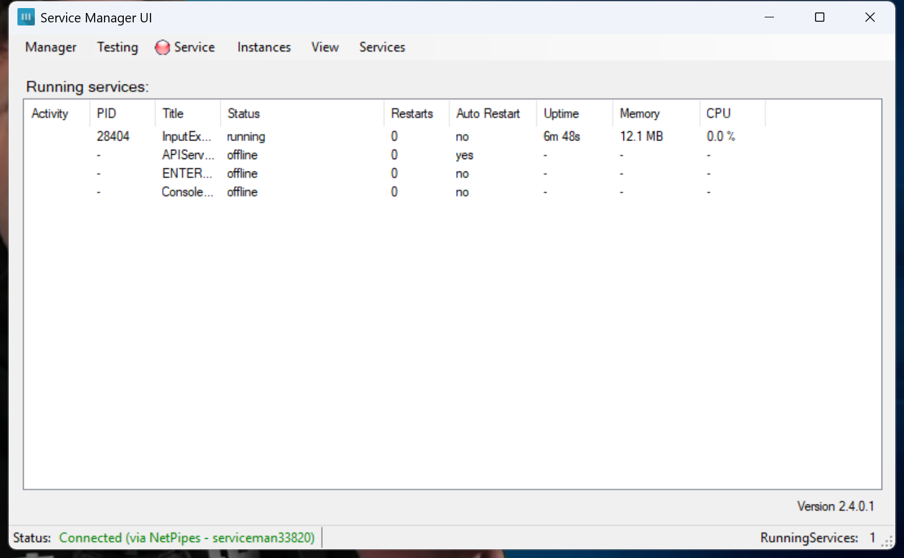

The operations that can take a while run behind a progress dialog: installing and removing the service,
starting, stopping and restarting it, connecting to a ServiceManager and starting or ending a test run. The
window stays responsive while they work. An operation runs to its end, the dialog cannot be closed before it
is through: stopping half way would leave the service or the connection half changed.


## Service List Columns

The service list shows one row per service and a set of columns next to it. Which columns are there and in
which order they appear is defined in `ServiceManager.UI\Columns\ServiceColumnLayout.cs`, so a new column is
described in one place: the heading, the width, whether the user can switch it off and whether it is on by
default. The heading in the list and the entry in the View menu come from the same description.

The View menu lists every column that can be switched off and ticks the ones that are visible. The choice
belongs to the Windows account and is stored in `%LOCALAPPDATA%\ServiceManager\ui.cfg`, so a small list on one
machine stays small on the next start. The Activity column stays, as it holds the icon and the check box.

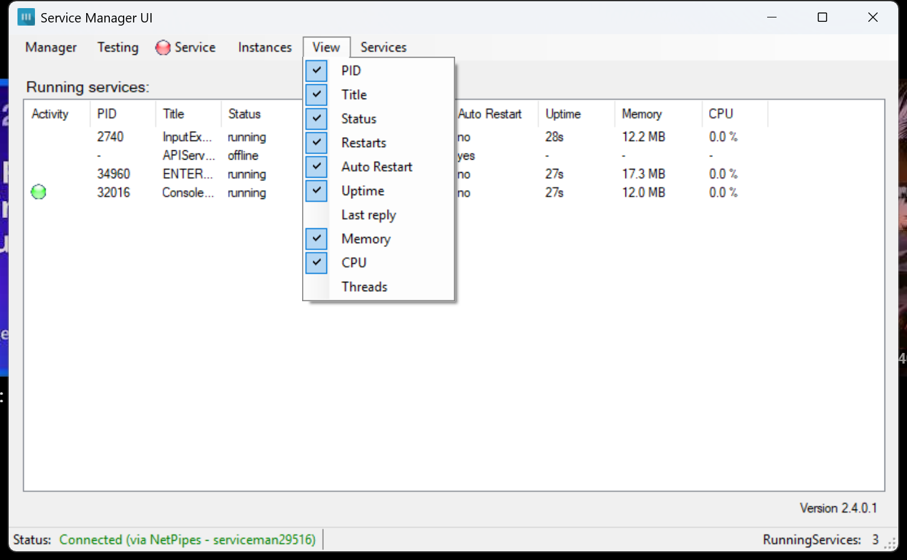

Memory, processor use and the thread count are measured by the ServiceManager itself, once per refresh of the
list, and travel to the interface with the analytics of the service. The processor value is the difference
between two refreshes, so the first value for a service appears one refresh after it starts. A value that
cannot be measured shows as a dash: a service that is not running has no process, and a process that ends
between two refreshes is gone before it can be measured.

The uptime is the age of the process start time, the last reply is the age of the last time the ServiceManager
saw the service running. Both are relative to the clock of the machine that measures them, so a list showing a
remote ServiceManager compares those times with the clock of the local machine.


## Network Settings

Choose between Net Pipes and TCP connection for your Service Manager.

*Who may connect* decides which clients the ServiceManager answers. *Administrators only* is the default, and the
service has to be restarted after the rule changes.

The list beside it holds the accounts of the two rules that name accounts. *Add* asks for the Windows account,
*Remove* drops the selected entry, and double-clicking an entry changes its name. Nothing else is asked for: the
caller signs in over the transport, and the service only compares that account with the list.

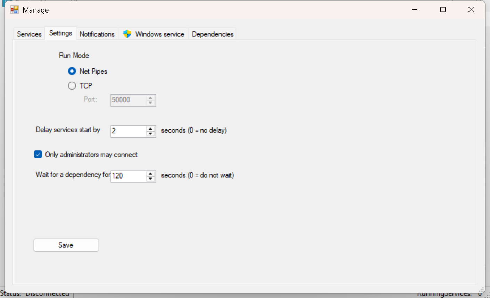

## Network Security

Both transports check the caller before a single managed service can be read or started. Five rules exist:

| Rule | Who may connect | Used by |
|------|-----------------|---------|
| Administrators | members of the local Administrators group | the installed service, this is the default |
| OwnUser | the account that runs the service | the test run inside the UI |
| Everyone | any process that can reach the endpoint | only when the rule is chosen on purpose |
| Users | administrators, and the accounts named in the settings | an ordinary account on a machine you cannot promote |
| UsersOnly | only the accounts named in the settings | a machine where the administrators sign in as well |

A named account is the account that signs in over the transport. The named pipes and Windows authenticated TCP
hand the service the `DOMAIN\user` of the caller, and the service compares that name with its list, so nothing but
the Windows logon proves the caller. The two rules are therefore only as strong as the logon of the machine the
request comes from: use them on the named pipes, or on a TCP endpoint of the local machine or behind a network you
trust.

An entry is written the way Windows writes the account: `MACHINE\bob` for a local account and `DOMAIN\bob` for a
domain account. The plain `bob` stands for `MACHINE\bob` of the machine the service runs on, so the two spellings of
one account match each other while the identically named account of another machine never does. Windows names a
domain account by its NetBIOS domain, so write `CORP\bob` rather than `bob@corp.example`.

A request that does not match its rule is refused before the service call runs. The check runs on every call
rather than only while the connection is opened: WCF protects a named pipe with its own default security, but a
service running as `NT AUTHORITY\NETWORK SERVICE` or `NT AUTHORITY\SERVICE` sits outside the usual user ACL and can
still open the pipe, and a TCP endpoint has no such list at all.

What that means in practice:

- Start the UI elevated, through *Run as administrator*. A UI that is not elevated can no longer connect to the
  installed service, and it says so when the connection fails.
- A UI that is not elevated carries the Windows shield in front of the entries that ask for it: the six entries
  under *Service* and the Windows service tab of the settings. The entries stay clickable, the shield only says
  that the operation will ask for the rights.
- A script that talks to the ServiceManager has to run elevated as well.
- *Testing* -> *Start testing* needs no administrator rights. That run hosts the service inside the UI process and
  answers the account of that process only, so the endpoint stays closed for every other local account.
- An ordinary account connects through *Manager* -> *Connect to*, which asks for the host and the port only: the
  account that runs the UI signs the request, so that account has to be in the list.
- *Only the accounts below* closes the endpoint for the administrators as well: every account that wants to connect
  needs an entry in the list.
- Choose *Everyone* to hand the endpoint to any local account again. The rule is stored as `Access` in
  `default.cfg`, and as the older `RequireAdministrator` beside it, so a settings file of an older version keeps
  the service closed.

The endpoints also limit what a caller can send: 64 KB per message on the service side, with a bounded depth and
size for the XML reader, and at most 20 open sessions and 16 calls at the same time. The console and error output
the service keeps in memory is limited to the last 256 KB per stream, oldest lines first, so a chatty console can
no longer grow the process without bounds.

## Windows Service Settings

Open `Service` -> `Service settings`, or the `Windows service` tab under `Manager` -> `Open config`.
This tab has its own Save button, separate from the connection and runtime settings on the Settings tab.
These settings configure the local Windows service, not a remotely connected instance or an individual
managed application. Applying them to an installed service requires administrator rights. Installing or
uninstalling the service needs them as well; without them the application names the missing rights instead
of repeating the Windows error.

- **Start mode:** Automatic, Automatic (delayed start), Manual or Disabled.
- **Log on as:** Local System, Local Service, Network Service or a named user (`DOMAIN\User` or
  `.\User`). A user account needs the *Log on as a service* right; ServiceManager grants it when
  applying or installing the service. File, configuration and application access rights must still
  be granted separately. A domain policy can override local logon rights.
- **New password:** leave blank to keep the stored password. Selecting a different user account
  requires a new password. Passwords are protected with DPAPI for this machine in `config\default.cfg`;
  another machine cannot decrypt them. Machine-scoped DPAPI does not replace file access controls:
  restrict access to the configuration file and its backups.
- **Dependencies:** None, Standard network (`Tcpip`, `Dhcp`, `Dnscache`) or Custom. Custom takes one
  Windows service name per line, not its display name. The standard list is shown read-only.

The Windows service tab lists configured dependencies by display name, service name and status. Select
**Own list** and **Select...** to filter services by either name and choose more than one; filtering keeps
checked services selected. A dependency that is no longer installed stays visible so it can be removed.

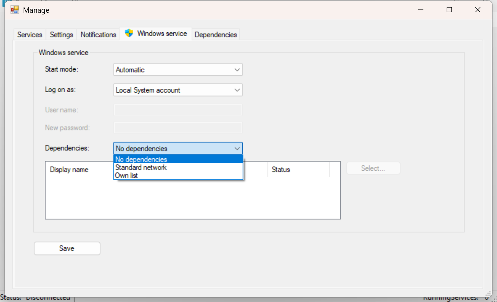

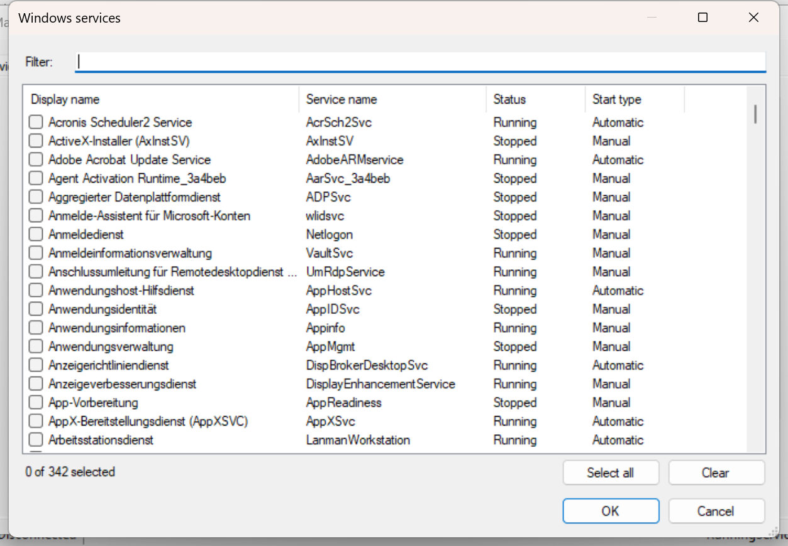

Saving applies changes immediately to an installed service and stores the same values for reinstallation.
Failures are shown and the dialog stays open; after a partial application, check the Windows service
configuration before retrying. If the service is not installed yet, saving only stores its future settings.
An account change offers to restart a running service, except when the new start mode is Disabled.
A restart also stops its managed applications. Startup and dependency changes alone need no restart.

Dependencies can delay ServiceManager at boot. Stopping a dependency may also require stopping
ServiceManager and its managed applications. Older settings files retain the previous defaults:
Automatic, Local System and the three standard network dependencies.

## Service Log

A Windows service has no console, so ServiceManager writes what the service, the extension loader and the
providers report into a text file instead: one file per day in a `logs` folder next to the executable. Every
line carries its time and a level, and a warning or an error additionally goes into the application event log
under the source `ServiceManager`. A day file older than fourteen days is dropped once a new day starts.

Alongside those technical messages the log also carries the lifecycle: the instance reports when it starts and
when it goes down, and every managed application that comes up, stops, crashes or is held back by a dependency
gets a line of its own. A crash is an error and therefore reaches the event log as well, a dependency that
holds a service back is a warning, everything else is an information. The lines are the ones the notification
providers receive, so the log and a Telegram message say the same thing. The console output of the managed
applications is left out on purpose: it would flood the file and it has its own capture, as described below.

**Manager → Open log** lists those files, newest day first, with warnings in amber and errors in red.
*Reload* (F5) reads the folder and the open day again, *Auto refresh* follows the running service every two
seconds, *Open folder* opens the `logs` folder in Explorer.

The console output of a managed application is captured separately and stored under `logs\<id>\`.
See [Service Settings - Logging](#service-settings---logging).

## Notifications

Notifications stay off until at least one provider is listed. They are configured in one place only:
`Manager` -> `Open config` -> the `Notifications` tab.

Six providers ship in the box, and each one is switched on per event, so the same event can go into the
event log and to a webhook while Telegram only receives the errors:

| Provider | Needs | Reachable |
| --- | --- | --- |
| [Script Hook](#notifications---script-hook) | a program on the machine | whatever that program can do |
| [SMTP Mail](#notifications---smtp-mail) | an SMTP server, or the pickup folder of IIS | any inbox |
| [Syslog](#notifications---syslog) | a collector over UDP or TCP | a log server on the network |
| [Telegram](#notifications---telegram) | internet access, a bot token | anywhere the ServiceManager has internet |
| [Webhook](#notifications---webhook) | internet access or a local endpoint | any tool that accepts a request |
| [Windows Event Log](#notifications---windows-event-log) | no network, administrator rights for the first entry | the machine the service runs on |

### Notification Settings

Pick every provider that should react to an event and decide per provider which events it receives.
Add registers a provider, Remove drops it again, Configure opens the settings of the selected one.
An empty list switches notifications off, a provider that is not listed never receives a message.

A provider whose own settings are still incomplete is marked with a warning icon, and the line beside
the list names the fields that are empty: *SMTP server*, *Sender* and *Recipient(s)* for the mail
provider, *Syslog host*, *Program*, *URL*, *API Key* and *Chat Id* for the others. The provider answers
that question itself, so an extension written before this warning simply stays unmarked. The Windows
Event Log provider is never incomplete: source name and log come with a working default.

A settings file of an older version keeps working: its single provider and the global ticks become
one entry of this list the first time the file is read.

The nine events are the ones the ServiceManager reports: *On Start*, *On Stop*, *On Restart* and
*On Service Crashed* belong to a managed service, *On Console Output* and *On Console Error* to its
console, *On Dependency Wait* to a service that waits for a Windows service, *On Server Start* and
*On Server Shutdown* to the ServiceManager itself. A crash is only reported when a process ends on its
own, a stop through the stop button or a shutdown of the ServiceManager stays *On Stop*.

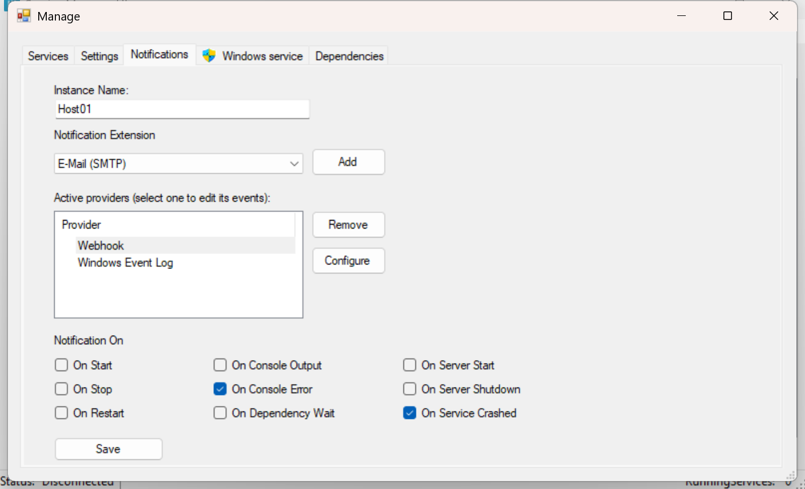

### Notifications - Script Hook

A program on the machine receives the event: a batch file, a PowerShell script, a Node tool, anything that
can be started. It is started directly rather than through a shell, so a path with a space or an ampersand in
it stays one path.

The event is one json object, by default written to the standard input of the program. *Hand the event as one
extra argument* hands the same object as the last argument instead, for a program that reads its arguments.
The quoting follows the rules of the operating system, so a service name containing a quote cannot end the
argument early. *Arguments* is written behind the program exactly as it stands in the settings, and a program
that does not finish within the timeout is killed.

A non zero exit code counts as a refusal and the first line of the answer goes into the console of the
ServiceManager. The program is started once per event and never repeated.

### Notifications - SMTP Mail

One mail per event through the SMTP server of the installation. Port 25 unencrypted and 587 with STARTTLS
are what a mail server offers, 465 is not supported. Username and password stay empty for a server that
takes the machine as it is.

The subject names the prefix, the level, the instance and the service, so a mail rule can pick the errors out
before anyone reads them. The body stays plain text: the fields as a small table and the console line below
it, because a mail client hides every console line it mistakes for a tag. The same event inside *Seconds
between identical mails* is mailed once, which keeps a service that crashes every few seconds from filling
the inbox.

*Pickup directory* needs no server at all: the mail is written into the drop folder of the local SMTP service,
which is also the way to look at a message without sending it anywhere. The form has a test button that
writes a real mail through the configured settings.

### Notifications - Syslog

One line per event to a collector such as rsyslog, Graylog or the journal of a NAS. UDP is the usual
transport and needs no handshake, TCP reaches a collector that answers and reports what it did not take.

The line starts with the priority in angle brackets, which is the facility times eight plus the severity of
the event: an error on local0 reads 131, a warning 132. A facility outside 0 to 23 falls back to local0.
RFC 3164 is what an older collector expects, RFC 5424 adds the version and the zone of the sender. The stamp
is the time of the event rather than the time of sending, so the collector sees the order the events happened
in even when a delivery had to be repeated.

A collector cuts a line around 1024 bytes, so the provider cuts the text itself and keeps the header whole -
a cut line still names the service it came from. The test button of the form sends one line over the
configured transport and answers what the collector did not accept.

### Notifications - Telegram

Example of telegram messages you will receive when used.

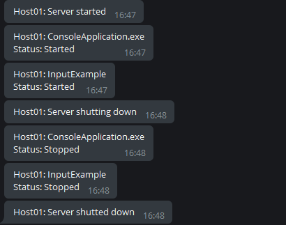

### Notifications - Webhook

One request to an endpoint of your choice. The body is written in the settings, so the same provider
serves a Slack incoming webhook, a Discord webhook, an n8n or Node-RED flow and an endpoint of your
own.

`{text}` `{details}` `{kind}` `{level}` `{service}` `{instance}` and `{timestamp}` are replaced.
Inside a JSON body the values are escaped, so a console line containing a quote cannot break the
message, while a plain text body receives them as they are. A placeholder the provider does not know
is sent untouched, which keeps templates written for another tool working.

Additional headers go one per line as `Name: value`, enough for an `Authorization` header of a hosted
service or the `X-...` header of a flow. A failed delivery is repeated as often as configured, the reason lands in
the console of the ServiceManager. The settings form has a test button that answers what the endpoint
replied, and it can accept a self signed certificate - for this one endpoint, not for the process.

### Notifications - Windows Event Log

The provider without any network: every event becomes an entry in the Windows Event Log and, when
enabled, a balloon tip on the desktop. It keeps working without internet access and while the service
runs with no user logged on - only the balloon tip needs an interactive session.

Registering the event source writes into the registry, so the first entry needs administrator rights;
the settings form says so while they are missing. Every kind of event gets its own event id and its
own category, which lets the Event Viewer filter on a single kind, e.g. all console errors.


## Service Settings - Start

Enable automatic start with the Service (system) and allow automatic restart when service ends or crashes.

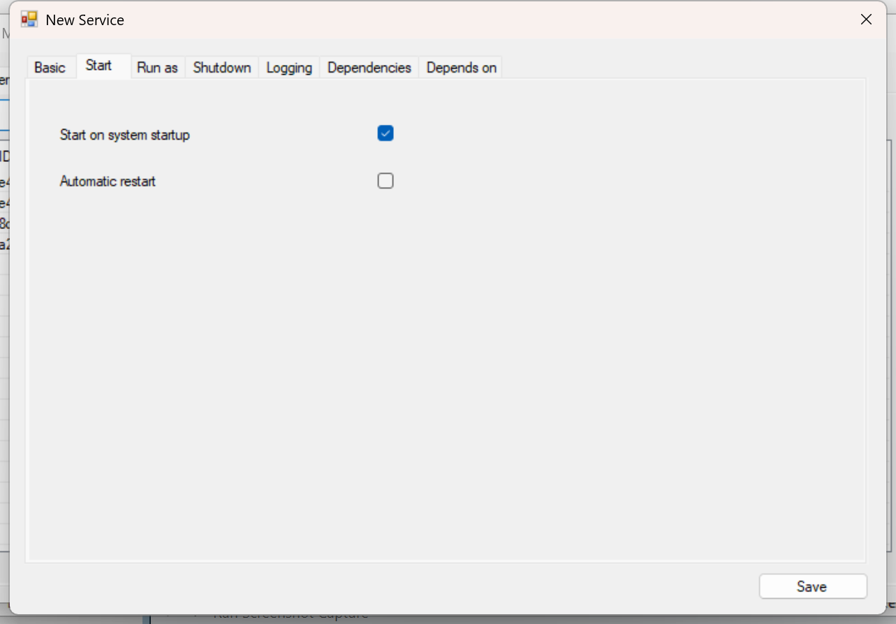

## Service Settings - Run as

By default a managed process runs under the account of ServiceManager: the machine account while ServiceManager
runs as a Windows service, the signed-in user while it is started from the user interface. **Run as** starts the
process under another account instead. Pick **Another account**, take it out of the list of the local accounts of
the machine or type its name, and add the password. A domain account works as well: the domain goes in its own box,
or the user name is written as `DOMAIN\user`.

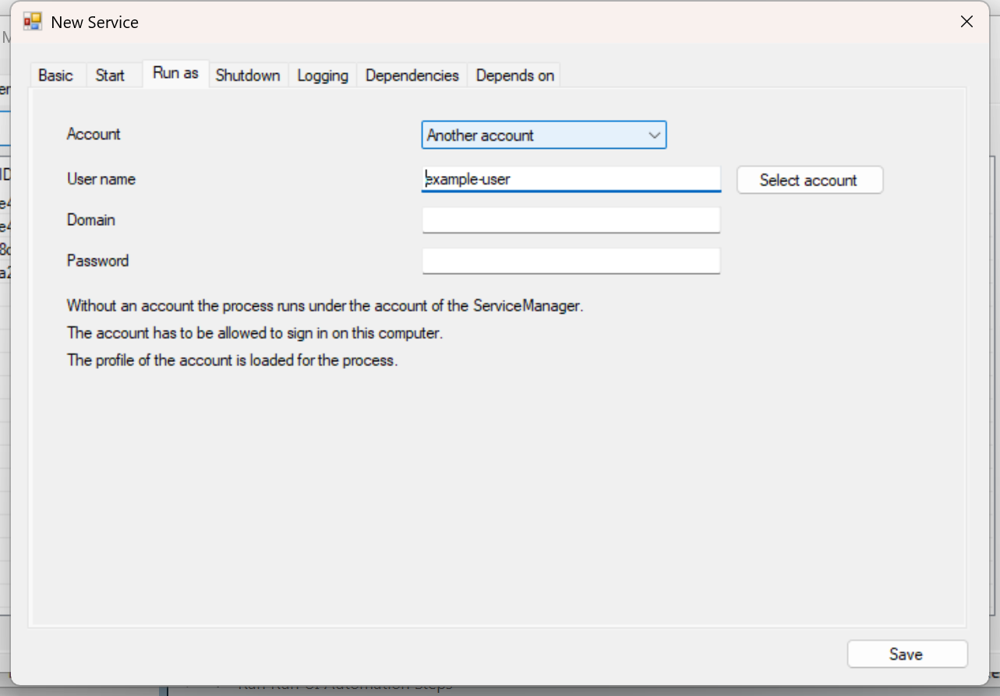

The account has to be allowed to sign in on the computer it runs on, the "Log on locally" right. Without that right
the logon is refused, the service goes offline and the log names the account that could not be used together with the
reason the operating system gave, for example `Logon failure: unknown user name or bad password (1326)`. That line goes
into the live log of the service as well, because a process that never started leaves no output of its own. The profile
of the account is loaded for the process, so the process gets its own AppData folders and its own registry hive under
HKEY_CURRENT_USER.

A stored password is never shown again: the settings dialog leaves the box empty and keeps the stored password until
a new one is typed. It is saved protected through Windows DPAPI for the whole machine, which means every
administrator of that machine can read it back.

The dialog offers the three accounts Windows builds in as well: **LocalSystem**, **LocalService** and
**NetworkService**. They have no password, their boxes stay empty and the account is logged on by its name alone.
That logon is only granted to a caller holding the trusted computing privilege, which the LocalSystem of an installed
Windows service has and a ServiceManager started from the desktop does not. A built-in account therefore only runs
while ServiceManager itself runs as a Windows service under LocalSystem. The dialog says so while it is started from
the desktop, and a start that was asked for anyway goes offline with that reason in the log. Such an account has no
profile of its own, the process gets its folders through the environment block of its token instead.

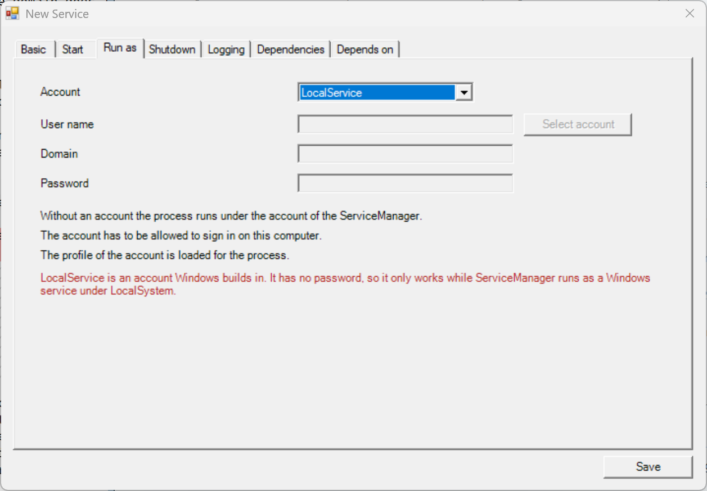

While ServiceManager itself runs as **LocalSystem** - the default of the Windows service installation - the
account is taken through a Windows token instead: ServiceManager logs the account in, takes a copy of its token
and has Windows start the process for that token. The plain logon of .NET cannot be used there, because it works
with the logon identifier of the caller and the LocalSystem token carries none; a service that is refused that way
went offline with `Access is denied (5)`. The interactive test run and a ServiceManager running under its own
account take the shorter way.

## Service Settings - Shutdown

Timeout before service gets killed when not responding to exit signal.

Good for console applications allow pressing ENTER before running Timeout.

After the timeout it will get killed.

Every step stands on its own. A step that was refused - a process of another account that will not take the input,
a window that is already gone - is named in the console of ServiceManager, in the error output of the service and
in its live log, and the next step is taken anyway. A service whose process cannot be reached is taken offline
rather than left in the list as running, and what was measured on it - the run time, the memory, the processor use
and the thread count - is cleared as soon as it is offline.

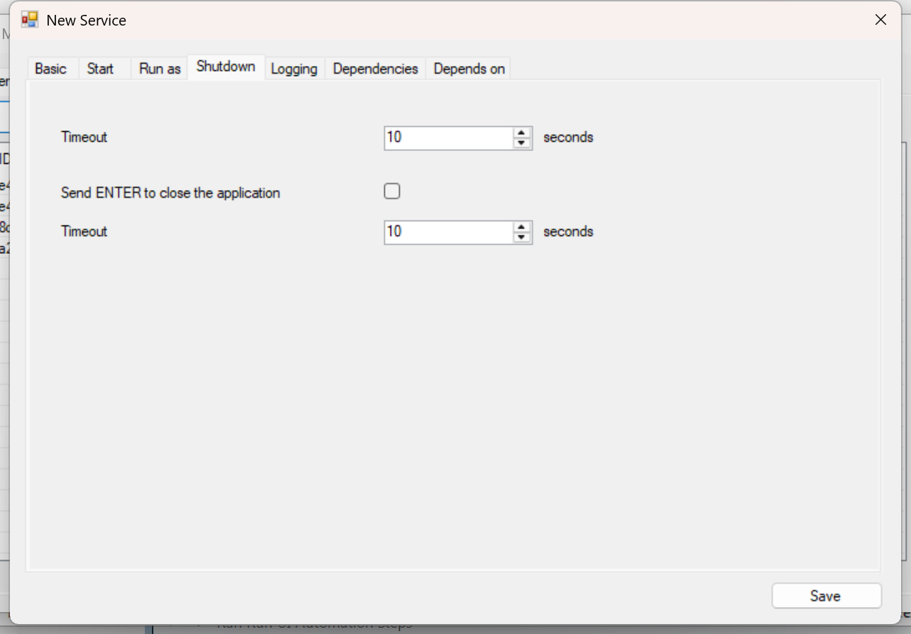

## Service Settings - Logging

Log your services console and error outputs right into memory /and on disk. So you can use the Live Console outputs full potential.

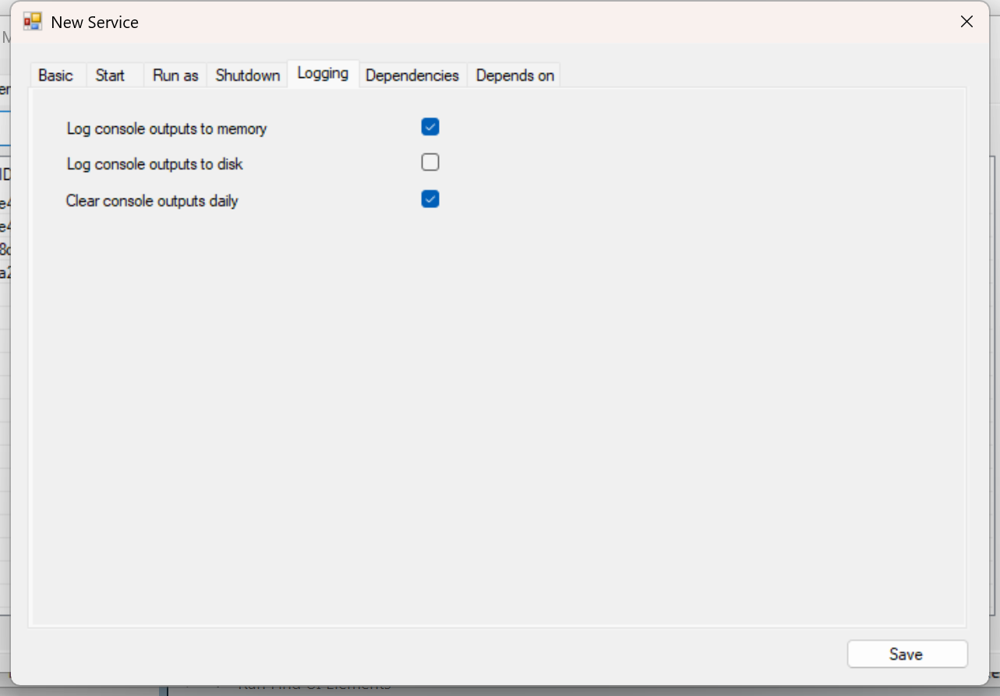

## Service Settings - Dependencies

A managed application can wait for other managed applications. On the **Depends on** tab of its settings
dialog, tick the services that have to run first: they are started in front, and where nothing waits for
anything the order of the service list is kept. A service that is disabled or was deleted holds nothing back.

Three rules decide what happens once the services are running. **When a dependency restarts** leaves the service
alone, restarts it together with the dependency, or stops it and leaves it stopped. **When a dependency did
not start** starts the service anyway, which is what ServiceManager did before, or takes it offline. **When a
dependency stops** leaves the service running, which is what ServiceManager did before, or stops it as well. All
three rules reach through the services below, level by level.

A service that is stopped through the menu or the log window goes through the stop rule of every service that
waits for it. So does a service that ends on its own and stays ended: the dependents that go with it are taken
offline as well. A service that is brought back by its own restart rule never reaches this point, and taking the
whole instance offline follows the shutdown order described below instead of the rules.

Services that wait for each other are refused in the dialog. A settings file that already holds such a circle
is loaded anyway: the circle is reported through the *On Dependency Wait* event and the services start in the
order of the list rather than not at all. Deleting a service names every service that waits for it and removes
the entry from those lists.

At shutdown the services nothing waits for go down first, then their dependencies, one level after the other
and everything inside one level at the same time.


## Service Settings - Dependency Tree

The **Dependencies** tab of the service list shows the same relations as a tree. ServiceManager itself sits on
top, with the Windows services it waits for as leaves, and the services of the list hang below it: a service
under the service it waits for, the Windows services that service waits for below it again. The services nothing
waits for open a branch, a service that waits for two services hangs below both of them.

Nothing is hidden: a circle is closed by showing the service once again marked *(see above)*, the members of
a circle nothing reaches hang at the bottom marked *(circle)*, and a disabled service stays in the tree
marked *(disabled)*. Double-click a service to open its settings, double-click ServiceManager to open its own
tab. The tree is rebuilt whenever the tab is opened.

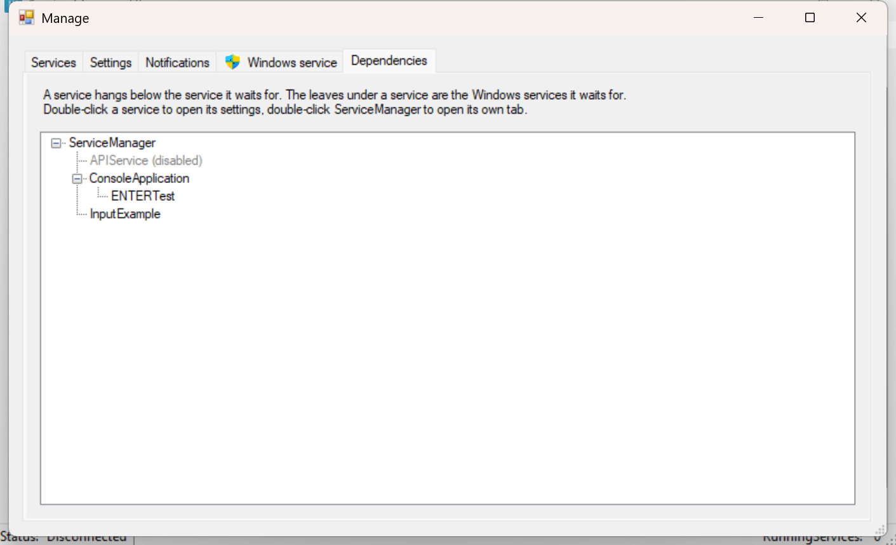


## Live Console In and Output

Get directly output from your console applications and send back informations over the network.


Example:

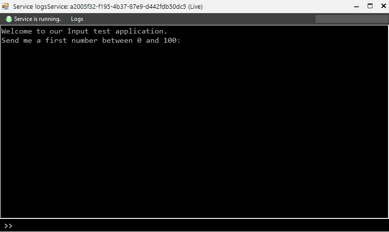

Icons where used from:
https://www.iconfinder.com/iconsets/ui-basic-glyph
