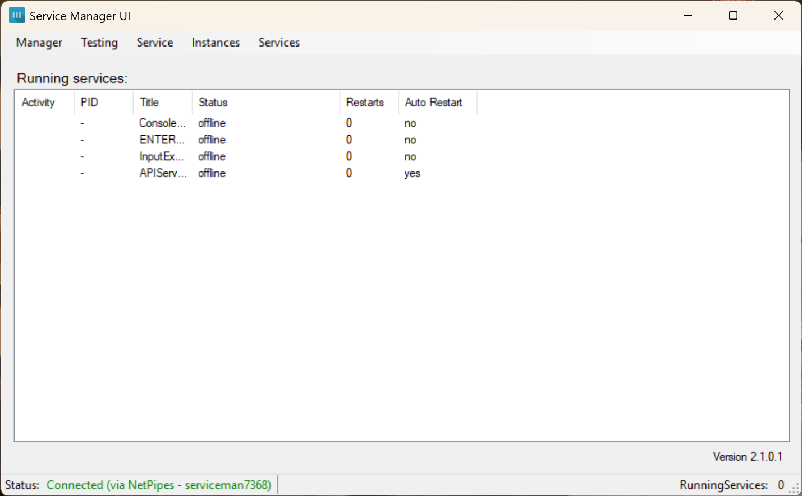
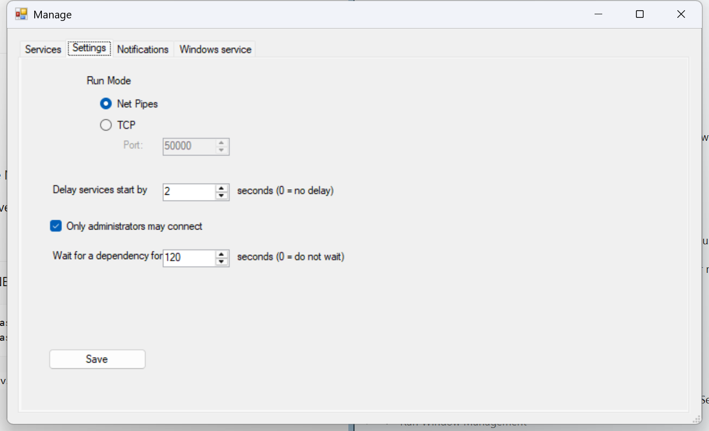
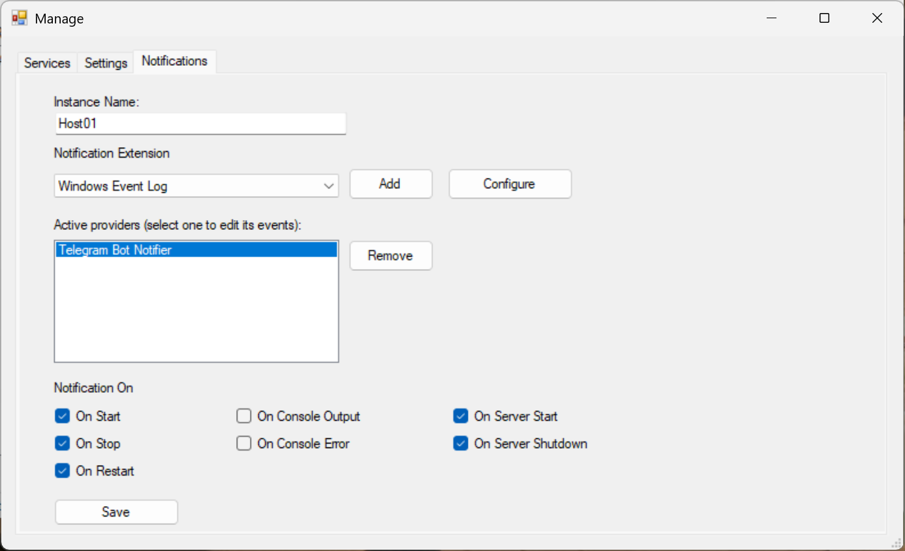
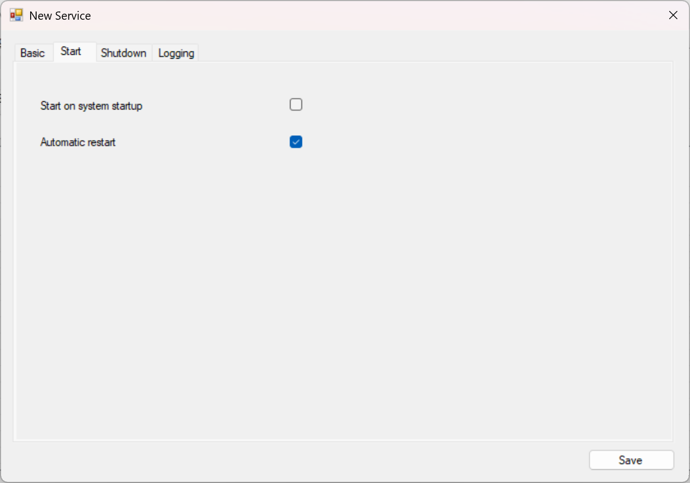
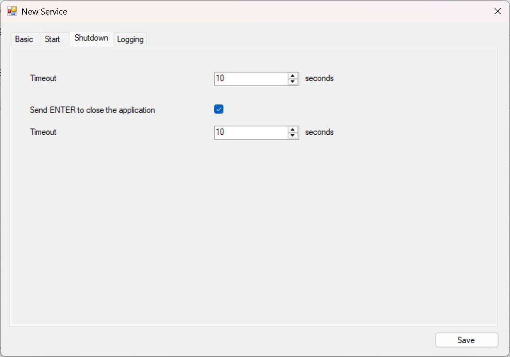
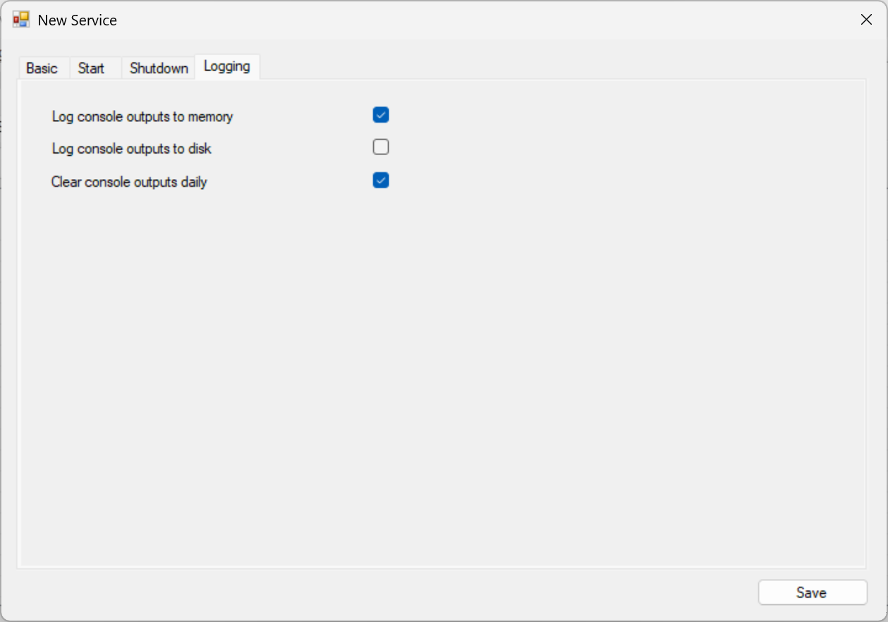
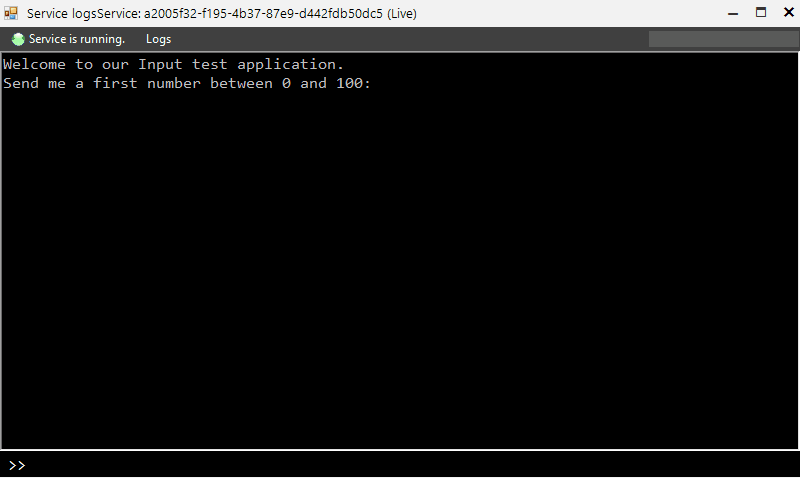
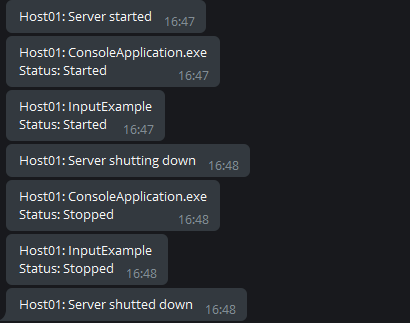

# ServiceManager
[](https://github.com/MajMcCloud/ServiceManager/actions/workflows/ci.yml)

A tool for managing mostly console applications like Cronjobs.

Developed with C# using the standard WinForms controls.

The network communication is done via WCF. It allows you to use Net Pipes or TCP connections with a custom Port.

Authentication is not integrated yet. => Todo List

## Build

Targets the .NET Framework 4.8.1 (the last version of the classic .NET Framework). The reference assemblies are restored from NuGet, so no targeting pack has to be installed. No third party UI controls, so a plain clone builds out of the box:

```
msbuild ServiceManager.sln /t:Restore /p:Configuration=Release
msbuild ServiceManager.sln /t:Rebuild /p:Configuration=Release
```

The same two commands run in [CI](.github/workflows/ci.yml), which uploads the `ServiceManager.Service\bin\Release` and `ServiceManagerUI\bin\Release` folders as build artifacts.

- [Main Window](#mainwindow)
- [Network Settings](#network-settings)
- [Notification Settings](#notification-settings)
- [Service Settings - Start](#service-settings---start)
- [Service Settings - Shutdown](#service-settings---shutdown)
- [Service Settings - Logging](#service-settings---logging)
- [Live Console In and Output](#live-console-in-and-output)
- [Notifications - Telegram](#notifications---telegram)

## MainWindow




## Network Settings

Choose between Net Pipes and TCP connection for your Service Manager.



## Notification Settings

Pick every provider that should react to an event and decide per provider which events it receives.
Add registers a provider, Remove drops it again, Configure opens the settings of the selected one.
An empty list switches notifications off, a provider that is not listed never receives a message.

A settings file of an older version keeps working: its single provider and the global ticks become
one entry of this list the first time the file is read.



## Service Settings - Start

Enable automatic start with the Service (system) and allow automatic restart when service ends or crashes.



## Service Settings - Shutdown

Timeout before service gets killed when not responding to exit signal.

Good for console applications allow pressing ENTER before running Timeout.

After the timeout it will get killed.



## Service Settings - Logging

Log your services console and error outputs right into memory /and on disk. So you can use the Live Console outputs full potential.




## Live Console In and Output

Get directly output from your console applications and send back informations over the network.


Example:



## Notifications - Telegram

Example of telegram messages you will receive when used.



## Notifications - Windows Event Log

The provider without any network: every event becomes an entry in the Windows Event Log and, when
enabled, a balloon tip on the desktop. It keeps working without internet access and while the service
runs with no user logged on - only the balloon tip needs an interactive session.

Registering the event source writes into the registry, so the first entry needs administrator rights;
the settings form says so while they are missing. Every kind of event gets its own event id and its
own category, which lets the Event Viewer filter on a single kind, e.g. all console errors.

Icons where used from:
https://www.iconfinder.com/iconsets/ui-basic-glyph
